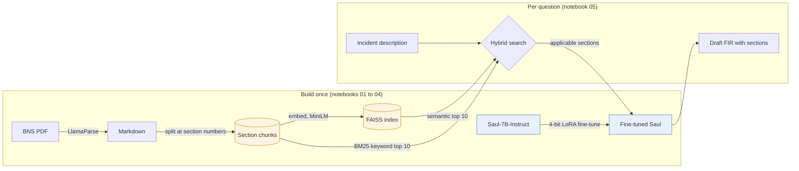

# Legal Ease

Drafts a First Information Report (FIR) from a plain-language account of an incident. It retrieves the relevant sections of the Bharatiya Nyaya Sanhita (BNS) and passes them to a language model fine-tuned on Indian legal questions.



## How it works

| Step | Notebook | What it does |
|---|---|---|
| 1 | `01_pdf_to_md.ipynb` | Converts `data/BNS_original.pdf` to Markdown with LlamaParse, using parsing instructions that normalise headings and illustrations. |
| 2 | `02_chunking.ipynb` | Splits the Markdown at section numbers into `data/legal_chunks.json`, within minimum and maximum chunk lengths. |
| 3 | `03_faiss-cpu.ipynb` | Embeds every chunk with a sentence-transformers model and stores the vectors in a FAISS index (`data/legal_faiss_cpu_1.index`). |
| 4 | `04_saul_finetune.ipynb` | Fine-tunes `Equall/Saul-7B-Instruct-v1` with 4-bit LoRA (rank 8, alpha 16) on the `nyayasathi` legal instruction dataset. |
| 5 | `05_legal-ease.ipynb` | Runs hybrid retrieval (FAISS semantic search plus BM25 keyword search, top 10 from each), then asks the fine-tuned model to write the FIR from the retrieved sections. |

## Run it

```bash
pip install -r requirements.txt
```

Run the notebooks in order. Steps 1 and 4 need a LlamaParse API key and a GPU (the fine-tune was built for Colab). Step 5 reuses the index and chunks already in `data/`.

## Limits

This is a research prototype. It does not give legal advice, and a generated FIR must be checked against the Act by a person before anyone files it. Retrieval quality was not benchmarked in this repo.

## Licence

MIT. See [LICENSE](LICENSE).
